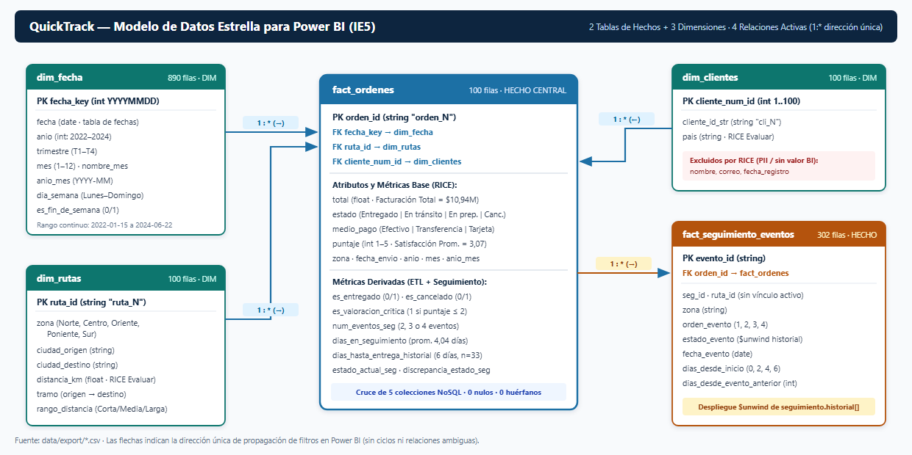
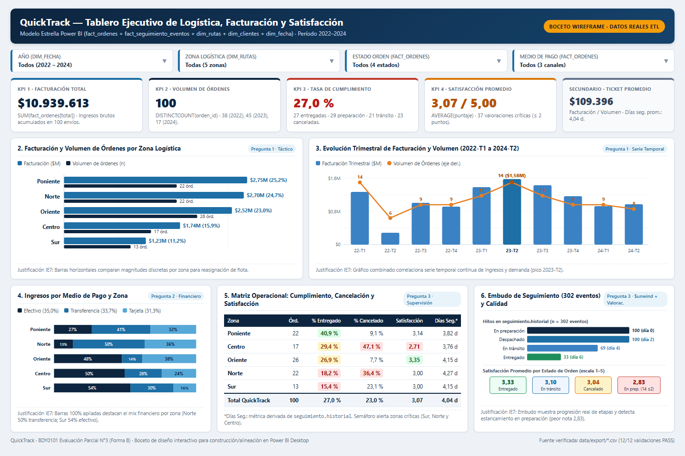
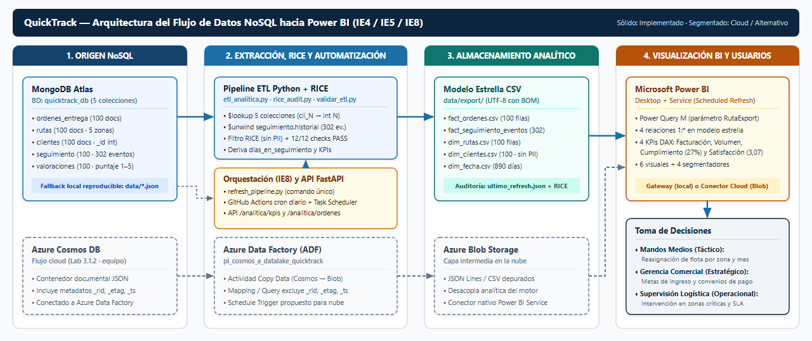

# Informe Técnico: Explotación de Datos NoSQL y Visualización Analítica en QuickTrack

**Evaluación Parcial N°3 — BDY0101 Base de Datos No Relacionales (Duoc UC)**

| Campo | Detalle |
|---|---|
| **Caso de Negocio** | QuickTrack (Forma B — Logística Express Nacional) |
| **Asignatura / Ponderación** | BDY0101 · Base de Datos No Relacionales (20 % de la asignatura) |
| **Integrantes** | **[PENDIENTE: Nombre Integrante 1 · Nombre Integrante 2]** |
| **Fecha de Entrega** | **[PENDIENTE: Fecha de Entrega]** |
| **Repositorio Git** | https://github.com/Francoseguel/QuickTrack |

---

## 1. Objetivos del Proyecto

### 1.1 Problema, Motivación y Contexto
**QuickTrack** es una empresa de logística express con cobertura nacional que registra su operación diaria sobre una base de datos documental NoSQL (**MongoDB Atlas**, base `quicktrack_db`) compuesta por cinco colecciones: `ordenes_entrega`, `rutas`, `clientes`, `seguimiento` y `valoraciones` (100 documentos por colección, período enero 2022 – junio 2024).

Si bien el modelo documental facilita la captura ágil de eventos operativos y arreglos embebidos (como `seguimiento.historial`), la dispersión en cinco colecciones, la existencia de inconsistencias de tipo entre identificadores (`"cli_N"` en texto frente a `_id` entero en `clientes`) y la presencia de atributos operativos/PII no agregables impiden que la gerencia responda directamente preguntas de negocio sobre rentabilidad por zona, cumplimiento de plazos y satisfacción del cliente.

El **objetivo general** del proyecto es diseñar, implementar y documentar un flujo completo de extracción, depuración (RICE), modelado estrella, visualización interactiva en **Power BI** y actualización automatizada a partir de MongoDB Atlas (con respaldo cloud en Azure Cosmos DB / Azure Data Factory), transformando los datos NoSQL de QuickTrack en indicadores estratégicos auditables.

### 1.2 Pregunta General de Negocio y Tres Ejes Analíticos

> **Pregunta General de Negocio:** ¿Cuál es el volumen de órdenes de entrega, la facturación total, la tasa de cumplimiento de entregas y la satisfacción promedio generada por QuickTrack, desagregados por período, zona logística y medio de pago?

Para responder a los distintos niveles organizacionales, el análisis se estructura en **tres ejes**:
1. **Eje Táctico (Temporal y Geográfico — Pregunta 1):** ¿Qué zonas logísticas concentran el mayor número de despachos y facturación a lo largo del tiempo?
2. **Eje Estratégico (Financiero — Pregunta 2):** ¿Cuál es la distribución de los ingresos totales según el medio de pago utilizado en cada zona logística?
3. **Eje Operacional y Calidad de Servicio (Cumplimiento y Satisfacción — Pregunta 3):** ¿Qué porcentaje de las órdenes finaliza en estado *Entregado* frente a *En tránsito*, *En preparación* o *Cancelado* por zona, cómo progresan sus eventos de seguimiento y cuál es la satisfacción percibida por el cliente?

---

## 2. Descripción de la Necesidad Cubierta

La arquitectura analítica desarrollada resuelve la brecha entre los registros transaccionales JSON y las decisiones diarias, mensuales y estratégicas de tres áreas funcionales:

| Nivel / Área Funcional | Necesidad Operativa Detectada | Decisión Habilitada con Datos Reales de QuickTrack |
|---|---|---|
| **Mandos Medios — Operaciones** (Gestión Mensual / Táctica) | Desconocimiento de la concentración geográfica y estacionalidad de la demanda y facturación. | Reasignación dinámica de flota hacia **Poniente** (`$2.751.194,22`; 25,15 % de ingresos) y **Oriente** (mayor volumen con 26 órdenes), planificando capacidad ante picos como **2023-T2** (`$1.581.181`; 14 órdenes). |
| **Gerencia Comercial y Finanzas** (Planificación Estratégica) | Falta de visibilidad del mix de ingresos por canal de pago y sector geográfico. | Definición de metas comerciales y acuerdos de recaudación según preferencia zonal: **Transferencia** domina en Norte (50,4 %) y Poniente (41,2 %), mientras **Efectivo** concentra el 53,7 % en Sur y 49,7 % en Centro. |
| **Supervisión Logística y Atención al Cliente** (Control Operacional) | Imposibilidad de cruzar tasas de cancelación, progresión de seguimiento y valoraciones bajas para intervenir rutas críticas. | Priorización inmediata en **Sur** (15,4 % entrega), **Norte** (18,2 % entrega; 36,4 % cancelación) y **Centro** (47,1 % cancelación y peor satisfacción `2,71/5,00`), además de auditar la desincronización detectada entre el estado de la orden y `seguimiento.estado_actual` (82 % de los registros). |

---

## 3. Proceso de Extracción de Datos (IE1)

### 3.1 Arquitectura de Conexión y Esquema Real Consultado
La conexión a **MongoDB Atlas** (`quicktrack_db`) se gestiona en modo **solo lectura** desde Python 3.11 mediante `config/database.py` (`pymongo==4.6.1`, `dnspython`, `certifi` para validación TLS y `python-dotenv` cargando exclusivamente el `.env` del repositorio, nunca versionado en Git). Para garantizar reproducibilidad sin exponer credenciales, `scripts/etl_analitica.py` implementa `--source auto` (intenta Atlas si existe `MONGO_URI` válida y realiza *fallback* transparente a `--source local` leyendo `data/*.json`, informando explícitamente el modo ejecutado).

Se consultan simultáneamente **las 5 colecciones reales** (superando el mínimo de 3 exigido por IE1):
- `ordenes_entrega` (100 docs, JSON Lines): `_id`, `cliente_id` (`"cli_N"`), `ruta_id`, `fecha_envio`, `estado`, `medio_pago`, `total`.
- `rutas` (100 docs, JSON Lines): `_id`, `zona`, `ciudad_origen`, `ciudad_destino`, `distancia_km`.
- `clientes` (100 docs, JSON Array): `_id` (`int`), `nombre`, `correo`, `pais`, `fecha_registro`.
- `seguimiento` (100 docs, JSON Lines): `_id`, `orden_id`, `estado_actual`, arreglo anidado `historial[{estado, fecha}]` (**302 eventos** totales).
- `valoraciones` (100 docs, JSON Lines): `_id`, `orden_id`, `puntaje` (1–5), `comentario`.

> **Aclaración de alcance del esquema:** Campos mencionados conceptualmente en el enunciado del caso que no existen en `data/*.json` (*tiempo estimado, condiciones climáticas, motivo de retraso, recomendación, tipo de cliente, peso*) **no fueron inventados**. Las métricas de duración del ciclo logístico (`dias_en_seguimiento` y `dias_hasta_entrega_historial`) se derivan estrictamente de las fechas reales de `seguimiento.historial`.

### 3.2 Pipelines Complejos de Agregación (`scripts/etl_analitica.py`)
El script ejecuta tres pipelines MongoDB documentados que combinan filtros (`$match`), normalización de clave (`$addFields` + `$toInt` + `$replaceOne`), cruces multi-colección (`$lookup` sobre 5 colecciones), despliegue de arreglos anidados (`$unwind` con `includeArrayIndex`) y proyección selectiva (`$project`):

```python
# Fragmento exacto de scripts/etl_analitica.py — Pipeline 1 (cruce de 5 colecciones)
PIPELINE_ORDENES_ANALITICA = [
    {"$match": {"_id": {"$ne": None}, "total": {"$gte": 0}}},
    {
        "$addFields": {
            "cliente_num_id": {
                "$ifNull": [
                    "$cliente_num_id",
                    {"$toInt": {"$replaceOne": {"input": "$cliente_id", "find": "cli_", "replacement": ""}}},
                ]
            }
        }
    },
    {"$lookup": {"from": "rutas", "localField": "ruta_id", "foreignField": "_id", "as": "info_ruta"}},
    {"$lookup": {"from": "clientes", "localField": "cliente_num_id", "foreignField": "_id", "as": "info_cliente"}},
    {"$lookup": {"from": "valoraciones", "localField": "_id", "foreignField": "orden_id", "as": "info_valoracion"}},
    {"$lookup": {"from": "seguimiento", "localField": "_id", "foreignField": "orden_id", "as": "info_seguimiento"}},
    {"$unwind": {"path": "$info_ruta", "preserveNullAndEmptyArrays": True}},
    {"$unwind": {"path": "$info_cliente", "preserveNullAndEmptyArrays": True}},
    {"$unwind": {"path": "$info_valoracion", "preserveNullAndEmptyArrays": True}},
    {"$unwind": {"path": "$info_seguimiento", "preserveNullAndEmptyArrays": True}},
    {
        "$project": {
            "_id": 0, "orden_id": "$_id", "cliente_id_str": "$cliente_id",
            "cliente_num_id": "$cliente_num_id", "ruta_id": "$ruta_id",
            "fecha_envio": "$fecha_envio", "estado": "$estado",
            "medio_pago": "$medio_pago", "total": "$total",
            "zona": "$info_ruta.zona", "ciudad_origen": "$info_ruta.ciudad_origen",
            "ciudad_destino": "$info_ruta.ciudad_destino", "distancia_km": "$info_ruta.distancia_km",
            "pais_cliente": "$info_cliente.pais", "puntaje": "$info_valoracion.puntaje",
            "estado_actual_seg": "$info_seguimiento.estado_actual",
            "historial": "$info_seguimiento.historial",
        }
    },
]

# Fragmento exacto de scripts/etl_analitica.py — Pipeline 2 ($unwind sobre arreglo anidado)
PIPELINE_SEGUIMIENTO_EVENTOS = [
    {"$match": {"historial": {"$exists": True, "$ne": []}}},
    {"$lookup": {"from": "ordenes_entrega", "localField": "orden_id", "foreignField": "_id", "as": "info_orden"}},
    {"$unwind": {"path": "$info_orden", "preserveNullAndEmptyArrays": False}},
    {"$lookup": {"from": "rutas", "localField": "info_orden.ruta_id", "foreignField": "_id", "as": "info_ruta"}},
    {"$unwind": {"path": "$info_ruta", "preserveNullAndEmptyArrays": True}},
    {"$unwind": {"path": "$historial", "includeArrayIndex": "orden_evento"}},
    {
        "$project": {
            "_id": 0, "seg_id": "$_id", "orden_id": "$orden_id",
            "ruta_id": "$info_orden.ruta_id", "zona": "$info_ruta.zona",
            "estado_orden": "$info_orden.estado", "estado_actual_seg": "$estado_actual",
            "orden_evento": {"$add": ["$orden_evento", 1]},
            "estado_evento": "$historial.estado", "fecha_evento": "$historial.fecha",
        }
    },
    {"$sort": {"orden_id": 1, "orden_evento": 1}},
]
```

Adicionalmente, el equipo configuró un flujo complementario en la nube mediante **Azure Data Factory** (`pl_cosmos_a_datalake_quicktrack`) que extrae documentos desde **Azure Cosmos DB** hacia **Azure Blob Storage** filtrando los metadatos internos del motor (`_rid`, `_self`, `_etag`, `_attachments`, `_ts`). **[PENDIENTE: captura de colecciones en MongoDB Atlas (`docs/capturas/04_atlas_colecciones.png`) y captura de ejecución Succeeded en Azure Data Factory (`docs/capturas/05_azure_adf_blob.png`)]**.

### 3.3 Resultados Verificados de Validación (`scripts/validar_etl.py`)
Al ejecutar `python scripts/refresh_pipeline.py --source auto` (modo ejecutado: `local`), el validador aprobó **12/12 pruebas** con cero desviaciones:
- Conteos exactos: `fact_ordenes` = `100/100`, `fact_seguimiento_eventos` = `302/302`, `dim_rutas` = `100/100`, `dim_clientes` = `100/100`, `dim_fecha` = `890` días continuos.
- Integridad: `0` claves nulas, `100 %` unicidad de PK y `0` registros huérfanos entre hechos y dimensiones.
- Cuadre de KPIs: Facturación CSV `$10.939.612,72` vs Fuente `$10.939.612,72` (`Dif = $0,0000`); Entregadas `27` vs `27`; Satisfacción Promedio `3,0700` vs `3,0700`.
- Cumplimiento RICE: `0` campos prohibidos/PII (`correo`, `nombre`, `comentario`, `fecha_registro`) presentes en `data/export/`.

---

## 4. Transformación y Documentación del Proceso (IE2)

### 4.1 Priorización Empírica de Atributos con Modelo RICE (`scripts/rice_audit.py`)
Se auditó el esquema real de las 5 colecciones mediante `scripts/rice_audit.py`, calculando empíricamente el factor **R** (proporción de documentos con valor no nulo/no vacío en escala `0–1`). Las escalas aplicadas son: **R** y **C** en `0–1`, **I** en `0,25 · 0,5 · 1 · 2 · 3`, **E** en `1–5`, fórmula `Puntaje = (R × I × C) ÷ E` y regla `≥ 1,00 Conservar`, `0,50–0,99 Evaluar`, `< 0,50 Descartar`. Las claves estructurales (`_id`, `cliente_id`, `ruta_id`, `orden_id`) se excluyen del puntaje por cumplir función de PK/FK.

#### Tabla 4.1 — Matriz RICE: Pregunta 1 (Eje Táctico — Temporal y Geográfico)
| Atributo Real | R (emp.) | I | C | E | Puntaje | Decisión | Justificación Técnica |
|---|---:|---:|---:|---:|---:|---|---|
| `rutas.zona` | 1,00 | 3,00 | 1,00 | 1 | **3,00** | **Conservar** | Agrupador geográfico principal de despachos e ingresos. |
| `ordenes_entrega.fecha_envio` | 1,00 | 3,00 | 1,00 | 1 | **3,00** | **Conservar** | Eje temporal indispensable para series mensuales y trimestrales. |
| `rutas.ciudad_origen` | 1,00 | 1,00 | 1,00 | 1 | **1,00** | **Conservar** | Desglosa nodos de despacho en `dim_rutas`. |
| `rutas.ciudad_destino` | 1,00 | 1,00 | 1,00 | 1 | **1,00** | **Conservar** | Identifica ciudades receptoras de alta demanda. |
| `rutas.distancia_km` | 1,00 | 2,00 | 0,90 | 2 | **0,90** | **Evaluar** | Métrica secundaria útil para eficiencia de tramos (incluida en `dim_rutas`). |
| `clientes.pais` | 1,00 | 1,00 | 0,80 | 1 | **0,80** | **Evaluar** | Segmentación geográfica complementaria en `dim_clientes`. |
| `clientes.correo` | 1,00 | 0,25 | 1,00 | 2 | **0,12** | **Descartar** | Dato PII de contacto sin valor analítico; excluido por privacidad. |
| `clientes.nombre` | 1,00 | 0,25 | 1,00 | 2 | **0,12** | **Descartar** | Atributo nominal PII irrelevante para agregaciones BI. |

#### Tabla 4.2 — Matriz RICE: Pregunta 2 (Eje Estratégico — Financiero)
| Atributo Real | R (emp.) | I | C | E | Puntaje | Decisión | Justificación Técnica |
|---|---:|---:|---:|---:|---:|---|---|
| `ordenes_entrega.total` | 1,00 | 3,00 | 1,00 | 1 | **3,00** | **Conservar** | Métrica monetaria base para Facturación Total (KPI 1) y Ticket Promedio. |
| `ordenes_entrega.medio_pago` | 1,00 | 2,00 | 1,00 | 1 | **2,00** | **Conservar** | Segmenta la recaudación por canal (Efectivo, Transferencia, Tarjeta). |
| `rutas.zona` | 1,00 | 3,00 | 1,00 | 1 | **3,00** | **Conservar** | Permite contrastar canales de pago por sector geográfico. |
| `ordenes_entrega.fecha_envio` | 1,00 | 3,00 | 1,00 | 1 | **3,00** | **Conservar** | Consolida cierres de facturación mensuales/anuales. |
| `clientes.fecha_registro` | 1,00 | 0,50 | 0,80 | 2 | **0,20** | **Descartar** | Fecha administrativa de alta sin incidencia en la distribución de ingresos. |

#### Tabla 4.3 — Matriz RICE: Pregunta 3 (Eje Operacional — Cumplimiento y Satisfacción)
| Atributo Real | R (emp.) | I | C | E | Puntaje | Decisión | Justificación Técnica |
|---|---:|---:|---:|---:|---:|---|---|
| `ordenes_entrega.estado` | 1,00 | 3,00 | 1,00 | 1 | **3,00** | **Conservar** | Estado oficial de la orden; base del KPI Tasa de Cumplimiento (% Entregado). |
| `valoraciones.puntaje` | 1,00 | 3,00 | 1,00 | 1 | **3,00** | **Conservar** | Calificación 1–5; base del KPI Satisfacción Promedio y alertas críticas (`<= 2`). |
| `seguimiento.historial[].estado` | 1,00 | 3,00 | 0,90 | 2 | **1,35** | **Conservar** | Arreglo anidado de hitos; requiere `$unwind` para auditar progresión logística. |
| `seguimiento.historial[].fecha` | 1,00 | 3,00 | 0,90 | 2 | **1,35** | **Conservar** | Habilita métricas derivadas de duración (`dias_en_seguimiento` y días a entrega). |
| `seguimiento.estado_actual` | 1,00 | 1,00 | 0,70 | 1 | **0,70** | **Evaluar** | Confianza reducida (`C=0,7`) por desfase en 82 % de órdenes; usado solo como bandera de auditoría. |
| `valoraciones.comentario` | 1,00 | 0,50 | 0,80 | 2 | **0,20** | **Descartar** | Texto cualitativo no agregable en medidas DAX numéricas; excluido del modelo principal. |

**Resumen RICE:** De **17 atributos únicos reales** auditados, **10 se conservan**, **3 quedan en evaluación** (integrados selectivamente en dimensiones/auditoría) y **4 se descartan** (`correo`, `nombre`, `fecha_registro`, `comentario`). Adicionalmente, la cobertura empírica del hito `"Entregado"` dentro de `seguimiento.historial` resultó en `33/100` (`R = 0,33`).

### 4.2 Operaciones de Transformación y Trazabilidad de Conteos
Todas las transformaciones se clasifican en tres ejes y registran conteos antes y después en `data/export/etl_metadata.json`:

| Tipo | Transformación Aplicada | Filas Antes → Después | Justificación de Negocio |
|---|---|---:|---|
| **Estructural** | Normalización de clave `"cli_N"` → `cliente_num_id` (`int`) y `$lookup` de 5 colecciones. | `100 → 100` | Sin esta conversión, el cruce con `clientes._id` (`int`) devuelve vacío; permite modelo estrella íntegro. |
| **Estructural** | Despliegue `$unwind` de `seguimiento.historial[]` hacia `fact_seguimiento_eventos.csv` y derivación de `dias_en_seguimiento` y `dias_hasta_entrega_historial`. | `100 docs → 302 eventos` | Elimina anidamiento incompatible con Power BI y permite medir el ciclo logístico real sin inventar tiempos estimados. |
| **Estructural** | Depuración RICE de dimensiones (`dim_clientes` sin PII) y generación de calendario continuo `dim_fecha`. | `95 fechas → 890 días` | Garantiza inteligencia de tiempo continua en Power BI y minimización de datos personales. |
| **Semántica** | Normalización de textos (`strip()` y colapso de espacios), clasificación `rango_distancia`, banderas `es_entregado`, `es_valoracion_critica` y `discrepancia_estado_seg`. | `100 → 100` | Evita duplicación de categorías en filtros/agrupaciones y visibiliza el desfase del 82 % entre orden y seguimiento. |
| **Formato y Calidad** | Conversión `fecha_envio` a ISO `YYYY-MM-DD`, `total` y `distancia_km` a `float64`, `puntaje` a `Int64`, control de duplicados/nulos/huérfanos y exportación CSV `UTF-8 con BOM`. | `100 → 100` (`0` descartes) | Asegura compatibilidad con tildes en español y evita errores de suma/división en Power Query y DAX. |

---

## 5. Selección e Integración en la Herramienta de Visualización (IE3, IE4)

### 5.1 Justificación de Power BI (4 Características Técnicas/Funcionales — IE3)
Se seleccionó **Microsoft Power BI Desktop / Service** sustentado en exactamente **cuatro capacidades** alineadas a QuickTrack:
1. **Conectividad Multi-Origen Nativa (Local y Cloud):** Ingiere de forma nativa los CSV UTF-8 generados por el ETL Python (`data/export/`), los contenedores de **Azure Blob Storage / Data Lake Gen2** alimentados por Azure Data Factory y los endpoints JSON de la API **FastAPI** (`/analitica/*`) mediante `Web.Contents`.
2. **Motor de Transformación Power Query (M):** Permite parametrizar la ruta de origen (`RutaExport`), aplicar tipado estricto con cultura explícita (`"en-US"` para el separador decimal `.`) y validar encabezados de manera reproducible sin tocar MongoDB.
3. **Modelado Tabular en Memoria (VertiPaq) y Lenguaje DAX:** Soporta relaciones `1:*` en esquema estrella y el cálculo dinámico de los 4 KPIs oficiales con contexto de filtro instantáneo al cruzar zona, período, estado y medio de pago.
4. **Interactividad Visual y Actualización Programada en la Nube:** Provee segmentadores sincronizados, formato condicional en matrices operacionales y publicación en **Power BI Service** con *Scheduled Refresh* (vía puerta de enlace local o conector cloud a Azure Blob Storage).

### 5.2 Método de Conexión y Carga (`powerbi/queries.m`)
Se adoptó una **arquitectura de capa intermedia desacoplada** (archivos CSV en modelo estrella en `data/export/`, con equivalente cloud en Azure Blob Storage), evitando ejecutar agregaciones analíticas pesadas directamente sobre el clúster transaccional M0 de MongoDB Atlas. En Power Query se define el parámetro `RutaExport` y cinco consultas M tipadas (`fact_ordenes`, `fact_seguimiento_eventos`, `dim_rutas`, `dim_clientes`, `dim_fecha`) usando `Encoding=65001` y cultura `"en-US"`. Como fuente alternativa bajo demanda se habilitaron los endpoints `GET /analitica/ordenes` y `GET /analitica/kpis` en FastAPI.

---

## 6. Modelo de Datos para el Dashboard (IE5)

Las cinco colecciones documentales se consolidaron en un **esquema estrella** de **2 tablas de hechos** y **3 dimensiones** con propagación determinística de filtros:



| Relación (1 → *) | Claves | Cardinalidad | Dirección de Filtro | Propósito Analítico |
|---|---|---|---|---|
| `dim_fecha` → `fact_ordenes` | `fecha_key` | `1 : *` | Única | Series mensuales, trimestrales y anuales continuas (890 días). |
| `dim_rutas` → `fact_ordenes` | `ruta_id` | `1 : *` | Única | Desglose de los 4 KPIs por zona logística, tramo y rango de distancia. |
| `dim_clientes` → `fact_ordenes` | `cliente_num_id` | `1 : *` | Única | Enlace limpio tras normalizar `"cli_N"` → `int` y análisis por país. |
| `fact_ordenes` → `fact_seguimiento_eventos` | `orden_id` | `1 : *` | Única | Propaga filtros de fecha, zona y estado hacia los 302 eventos de seguimiento sin crear ambigüedad con `dim_rutas`. |

**[PENDIENTE: captura de la Vista de Modelo en Power BI Desktop (`docs/capturas/01_modelo_estrella_powerbi.png`)]**

---

## 7. Diseño de Dashboard y Visualizaciones (IE6, IE7)

### 7.1 Boceto del Dashboard Interactivo y Evidencia Visual
El tablero sigue una jerarquía ejecutiva en tres bandas: (1) barra de 4 segmentadores sincronizados (`Año`, `Zona`, `Estado`, `Medio de Pago`) + 4 tarjetas KPI principales y 1 secundaria, (2) bloque táctico de desempeño zonal y evolución temporal, y (3) bloque financiero, matriz operacional de cumplimiento/satisfacción y embudo de trazabilidad de seguimiento.



> **[PENDIENTE: captura de pantalla del Dashboard completo en Power BI Desktop (`docs/capturas/02_dashboard_general.png`) y captura con filtro interactivo aplicado (`docs/capturas/03_dashboard_filtro_interactivo.png`), además de adjuntar o alinear el archivo `.pbix` del compañero en `powerbi/QuickTrack_Dashboard.pbix`.]**

### 7.2 Justificación del 100 % de las Visualizaciones (IE7)
| # | Visualización | Tipo de Dato | Objetivo Analítico / Pregunta | Área Funcional | Justificación Técnica |
|---|---|---|---|---|---|
| 1 | **Tarjetas KPI (4 oficiales + 1 secundaria)** | Métricas escalares agregadas | Pulso ejecutivo global (Pregunta General) | Gerencia General | Lectura inmediata de Facturación (`$10,94M`), Volumen (`100`), Cumplimiento (`27,0 %`) y Satisfacción (`3,07/5,00`) antes de filtrar. |
| 2 | **Barras Horizontales Agrupadas — Zona vs Facturación y Órdenes** | Categórico nominal (`zona`) + 2 cuantitativos | Concentración geográfica (Pregunta 1) | Operaciones / Mandos Medios | Compara magnitudes discretas entre las 5 zonas con máxima precisión visual (Poniente `$2,75M` en ingresos; Oriente `26` órdenes en volumen). |
| 3 | **Gráfico Combinado Columnas + Línea — Evolución Trimestral** | Serie temporal continua (`dim_fecha`) + 2 cuantitativos | Estacionalidad y tendencia (Pregunta 1) | Planificación / Mandos Medios | Correlaciona ingresos y volumen en un eje cronológico continuo (pico `2023-T2` con `$1,58M` y 14 órdenes; valle `2022-T2` con `$0,29M`). |
| 4 | **Barras 100 % Apiladas — Ingresos por Medio de Pago y Zona** | 2 categóricos (`zona`, `medio_pago`) + cuantitativo | Mix financiero por canal (Pregunta 2) | Gerencia Comercial / Finanzas | Destaca proporciones relativas dentro de cada zona (Norte 50,4 % Transferencia; Sur 53,7 % Efectivo) mejor que gráficos circulares múltiples. |
| 5 | **Matriz con Formato Condicional — Cumplimiento, Cancelación y Satisfacción** | Categórico (`zona`) + porcentajes y promedios | Detección de zonas críticas (Pregunta 3) | Supervisión Logística | Entrega cifras exactas con semáforo para intervenir **Sur** (`15,4 %` entrega), **Norte** (`36,4 %` cancelación) y **Centro** (`47,1 %` cancelación; nota `2,71`). |
| 6 | **Embudo de Hitos (`$unwind`) + Tarjetas de Satisfacción por Estado** | Categórico secuencial (`estado_evento`) + cuantitativos | Trazabilidad de retrasos y calidad (Pregunta 3) | Supervisión y Atención al Cliente | Evidencia la progresión real de los 302 eventos (`100 → 100 → 69 → 33` en 6 días) y muestra que las órdenes *En preparación* concentran la peor satisfacción (`2,83`; 14 notas ≤ 2). |
| 7 | **Panel de Segmentadores Interactivos** | Dimensiones discretas (4 slicers) | Exploración dinámica (IE6) | Todos los usuarios | Habilita filtrado cruzado instantáneo sobre todos los KPIs y gráficos sin crear múltiples reportes estáticos. |

---

## 8. Implementación de KPI y Automatización (IE8)

### 8.1 Los 4 KPIs Oficiales e Indicadores Secundarios (`powerbi/medidas.dax`)
Todos los cálculos son 100 % consistentes entre el ETL Python, las validaciones, el archivo `powerbi/medidas.dax` y este informe:

| KPI / Indicador | Fórmula DAX (`powerbi/medidas.dax`) | Valor Real Verificado | Origen en Modelo Estrella |
|---|---|---:|---|
| **1. Facturación Total** *(Principal)* | `SUM( fact_ordenes[total] )` | **`$10.939.612,72`** | `ordenes_entrega.total` |
| **2. Volumen de Órdenes** *(Principal)* | `DISTINCTCOUNT( fact_ordenes[orden_id] )` | **`100`** | `ordenes_entrega._id` |
| **3. Tasa de Cumplimiento** *(Principal)* | `DIVIDE( CALCULATE([Volumen Ordenes], fact_ordenes[estado] = "Entregado"), [Volumen Ordenes], 0 )` | **`27,0 %`** *(27/100)* | `ordenes_entrega.estado` |
| **4. Satisfacción Promedio** *(Principal)* | `AVERAGE( fact_ordenes[puntaje] )` | **`3,07 / 5,00`** | `valoraciones.puntaje` |
| *Ticket Promedio* *(Secundario)* | `DIVIDE( [Facturacion Total], [Volumen Ordenes], 0 )` | `$109.396,13` | Derivado KPI 1 / KPI 2 |
| *Tasa de Cancelación* *(Secundario)* | `DIVIDE( [Ordenes Canceladas], [Volumen Ordenes], 0 )` | `23,0 %` *(23/100)* | `ordenes_entrega.estado` |
| *Valoraciones Críticas (≤ 2)* *(Sec.)* | `CALCULATE( [Volumen Ordenes], fact_ordenes[puntaje] <= 2 )` | `37` *(37,0 %)* | `valoraciones.puntaje` |
| *Días Prom. Seguimiento* *(Derivado)* | `AVERAGE( fact_ordenes[dias_en_seguimiento] )` | `4,04 días` *(6,0 d entrega)* | `seguimiento.historial[].fecha` |

### 8.2 Automatización y Alcance Honesto de Actualización
> **Aclaración técnica:** La arquitectura implementada corresponde a **actualización automatizada programada (*batch*) y bajo demanda**, no a *streaming* en tiempo real sub-segundo.

- **Implementado y verificado en el repositorio:**
  1. **Orquestador único (`scripts/refresh_pipeline.py`):** Ejecuta en `~0,25 s` la secuencia `rice_audit.py` → `etl_analitica.py` → `validar_etl.py` (`12/12 PASS`) y emite el log auditable `data/export/ultimo_refresh.json`.
  2. **Programación CI/CD (`.github/workflows/refresh_analytics.yml`):** Workflow de GitHub Actions con `cron: "0 9 * * *"` (diario 06:00 CLT) y ejecución manual (`workflow_dispatch`). Lee `secrets.MONGO_URI`; si no está configurado, opera en modo `--source local` dejándolo registrado en el resumen del *job* y publica los CSV como artefacto.
  3. **Programación local en Windows:** Comando `schtasks` documentado en `docs/automatizacion.md` para ejecutar `refresh_pipeline.py --source auto` diariamente antes de abrir Power BI Desktop.
  4. **Endpoints analíticos FastAPI (`api/main.py`):** `/analitica/kpis`, `/analitica/rendimiento-zonas`, `/analitica/ordenes` y `/analitica/seguimiento-eventos` como fuente JSON alternativa bajo demanda.
- **Propuesto para despliegue en Power BI Service:**
  - *Opción A (CSV local):* Configurar **On-Premises Data Gateway** apuntando a `data/export/` y programar *Scheduled Refresh* en Power BI Service.
  - *Opción B (100 % Cloud Azure):* Agregar un *Schedule Trigger* al pipeline `pl_cosmos_a_datalake_quicktrack` de **Azure Data Factory** y conectar Power BI Service al contenedor de **Azure Blob Storage** sin gateway local.

---

## 9. Diagramas de Arquitectura del Flujo de Datos (IE4, IE5)

El diagrama siguiente sintetiza el flujo completo desde las fuentes NoSQL hasta los usuarios de negocio, diferenciando con línea sólida la tubería implementada y verificada en el repositorio, y con línea segmentada el flujo cloud complementario en Azure y la vía alternativa por API REST:



### 9.1 Síntesis de Responsabilidades por Capa Arquitectónica

| Capa | Tecnologías | Función en la Solución QuickTrack |
|---|---|---|
| **1. Origen NoSQL** | MongoDB Atlas (`quicktrack_db`) + Azure Cosmos DB | Persistencia transaccional de las 5 colecciones documentales (100 docs c/u; 302 eventos de seguimiento) y contenedor cloud complementario. |
| **2. Procesamiento y Automatización** | Python (`pymongo`, `pandas`), GitHub Actions, FastAPI, Azure Data Factory | Extracción en solo lectura, cruce multi-colección, `$unwind` de `historial`, auditoría RICE, validación 12/12 y programación diaria (o Copy Data en ADF). |
| **3. Almacenamiento Analítico** | Modelo Estrella CSV (`data/export/`) + Azure Blob Storage | Desacopla la carga analítica de la base operativa entregando 5 tablas depuradas sin PII ni metadatos internos (`_rid`, `_ts`). |
| **4. Visualización BI y Usuarios** | Power BI Desktop / Service (Power Query M, VertiPaq, DAX) | Explotación interactiva de los 4 KPIs oficiales y 6 visuales para Operaciones, Gerencia Comercial y Supervisión Logística. |

*(Los archivos fuente editables en Mermaid se encuentran en `docs/diagramas/arquitectura_flujo_datos.mmd` y `docs/diagramas/modelo_datos_estrella.mmd`.)*

---

## Anexo A — Tabla de Trazabilidad frente a la Rúbrica Oficial (IE1–IE8)

*(Nota: Las ponderaciones internas de IE1–IE8 suman 100 % de la evaluación; la Evaluación Parcial N°3 pondera un 20 % de la asignatura BDY0101.)*

| Indicador | Pond. | Sección del Informe | Evidencia Concreta en el Repositorio |
|---|---:|---|---|
| **IE1** Consultas complejas NoSQL (anidados, filtros, contexto) | 15 % | Secciones 3 y 4 | `scripts/etl_analitica.py` (3 pipelines MongoDB cruzando 5 colecciones, `$lookup`, `$unwind` de `seguimiento.historial`, `$match`, `$addFields`, `$project`). |
| **IE2** Documentación y justificación de transformaciones | 15 % | Sección 4 | `scripts/rice_audit.py`, `data/export/rice_auditoria.csv` (R empírico sobre 17 atributos en 3 tablas por eje), `data/export/etl_metadata.json` (conteos antes/después). |
| **IE3** Selección de Power BI con 4 características | 5 % | Sección 5 | `powerbi/modelo.md` (Sección 1) y Sección 5.1 del informe con exactamente 4 capacidades técnico-funcionales. |
| **IE4** Conexiones funcionales NoSQL → BI | 5 % | Secciones 3, 5 y 9 | `data/export/*.csv` (UTF-8 BOM), `scripts/validar_etl.py` (`12/12 PASS`), `powerbi/queries.m` parametrizado y endpoints `/analitica/*` en `api/main.py`. |
| **IE5** Modelado de datos para 4 KPIs clave | 10 % | Secciones 6 y 8 | `powerbi/modelo.md`, `docs/diagramas/modelo_datos_estrella.{mmd,svg,png}`, 5 tablas estrella y 4 KPIs DAX coherentes. |
| **IE6** Dashboard funcional e interactivo | 20 % | Sección 7 | `powerbi/boceto_dashboard.{html,png}`, `powerbi/guia_construccion.md`, `powerbi/medidas.dax`. *(Requiere adjuntar capturas y `.pbix` real del equipo).* |
| **IE7** Justificación del 100 % de visualizaciones | 10 % | Sección 7 | Tabla 7.2 y `powerbi/modelo.md` (Sección 3) cubriendo el 100 % de visuales (tarjetas, barras, combo, apiladas, matriz, embudo y slicers). |
| **IE8** Reportes automatizados destacando KPIs | 20 % | Sección 8 | `scripts/refresh_pipeline.py`, `.github/workflows/refresh_analytics.yml`, `docs/automatizacion.md`, `data/export/ultimo_refresh.json` y endpoints `/analitica/*`. |

---

## Anexo B — Pendientes Manuales del Equipo antes de Subir a AVA

1. **Portada del Informe:** Reemplazar `[PENDIENTE: Nombre Integrante 1 · Nombre Integrante 2]` y `[PENDIENTE: Fecha de Entrega]` y regenerar el PDF final.
2. **Seguridad (Urgente):** Rotar la contraseña del usuario `admin_quicktrack` en MongoDB Atlas (estuvo expuesta en el commit inicial `cc68f88` en `.env.example` y en los logs `gemini1.txt`/`gemini2.txt`).
3. **Archivo `.pbix` y Capturas de Power BI Desktop:** Construir o alinear el `.pbix` del compañero siguiendo `powerbi/guia_construccion.md`, guardarlo en `powerbi/QuickTrack_Dashboard.pbix` y capturar `docs/capturas/01_modelo_estrella_powerbi.png`, `02_dashboard_general.png` y `03_dashboard_filtro_interactivo.png`.
4. **Capturas Cloud (Atlas y Azure):** Adjuntar `docs/capturas/04_atlas_colecciones.png` (colecciones `quicktrack_db`) y `docs/capturas/05_azure_adf_blob.png` (ejecución *Succeeded* de `pl_cosmos_a_datalake_quicktrack` y JSON limpio en Blob Storage).
5. **Publicación Git y Entrega en AVA:** Revisar los commits locales, ejecutar `git push` tras tu confirmación y subir `docs/informe_tecnico_EP3.pdf` junto con el enlace al repositorio en AVA.
