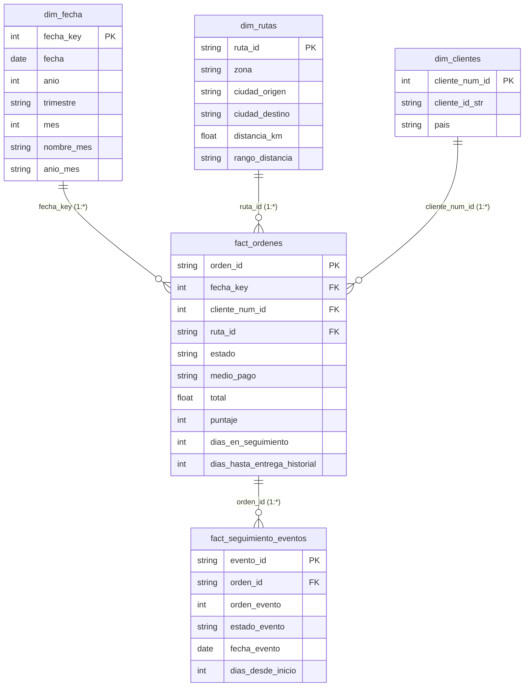

# Modelo de Datos, Selección de Power BI y Justificación de Visualizaciones

Este documento formaliza el diseño analítico de QuickTrack para cubrir los indicadores **IE3 (5%)**, **IE5 (10%)**, **IE6 (20%)** e **IE7 (10%)** de la rúbrica de la Evaluación Parcial N°3 (BDY0101).

---

## 1. Justificación de Power BI (IE3 — 4 Características Técnicas/Funcionales)

Se seleccionó **Microsoft Power BI Desktop / Service** frente a otras alternativas por cuatro capacidades técnicas y funcionales directamente alineadas a los requerimientos de QuickTrack:

1. **Conectividad Multi-Origen Nativa (Local y Cloud):** Soporta ingesta directa desde los archivos CSV generados por el ETL Python (`data/export/`), conectores nativos de **Azure Blob Storage / Data Lake Storage Gen2** (flujo Azure Data Factory desde Cosmos DB) y consumo de endpoints JSON de la **API REST FastAPI** (`/analitica/*`) mediante `Web.Contents`.
2. **Motor de Transformación Power Query (Lenguaje M):** Permite parametrizar la ruta de origen (`RutaExport`), imponer tipado estricto con cultura explícita (`"en-US"`), validar integridad de columnas y mantener el proceso de carga reproducible sin modificar la base transaccional NoSQL.
3. **Motor Analítico Tabular (VertiPaq) y Lenguaje DAX:** Habilita el modelado en **esquema estrella** y el cálculo dinámico en memoria de los 4 KPIs oficiales (*Facturación Total*, *Volumen de Órdenes*, *Tasa de Cumplimiento* y *Satisfacción Promedio*) junto con métricas derivadas de seguimiento, recalculándose instantáneamente bajo cualquier combinación de filtros cruzados.
4. **Interactividad Visual y Actualización Programada en Power BI Service:** Ofrece segmentadores sincronizados (Año, Zona, Estado, Medio de Pago), filtrado cruzado entre gráficos y publicación en la nube con *Scheduled Refresh* (vía puerta de enlace local o conector cloud a Azure Storage) para sostener reportes actualizables orientados a la toma de decisiones.

---

## 2. Arquitectura del Modelo Estrella (IE5)

Para evitar las limitaciones de una tabla plana única y resolver la relación `1:N` entre órdenes y eventos anidados de `seguimiento.historial`, las 5 colecciones NoSQL se modelaron en **2 tablas de hechos** y **3 dimensiones**:

### 2.1 Tablas y Granularidad

| Tabla | Rol | Grano | Filas base | Clave Primaria | Origen NoSQL |
|---|---|---|---:|---|---|
| `fact_ordenes` | Hecho principal | 1 fila por orden de entrega | 100 | `orden_id` | `ordenes_entrega` + `valoraciones` + métricas derivadas de `seguimiento` |
| `fact_seguimiento_eventos` | Hecho de trazabilidad | 1 fila por evento del arreglo `historial` (`$unwind`) | 302 | `evento_id` | `seguimiento.historial[]` + referencia de `ordenes_entrega` |
| `dim_rutas` | Dimensión geográfica | 1 fila por ruta logística | 100 | `ruta_id` | `rutas` (`zona`, `ciudad_origen`, `ciudad_destino`, `distancia_km`, `rango_distancia`) |
| `dim_clientes` | Dimensión de clientes | 1 fila por cliente (sin PII) | 100 | `cliente_num_id` | `clientes` (`_id`, `pais`; `nombre`, `correo` y `fecha_registro` excluidos por RICE) |
| `dim_fecha` | Dimensión calendario | 1 fila por día continuo | 890 | `fecha_key` | Generada en ETL desde `2022-01-15` hasta `2024-06-22` |

### 2.2 Relaciones, Cardinalidades y Dirección de Filtro

| Tabla Origen (1) | Columna PK | Tabla Destino (*) | Columna FK | Cardinalidad | Dirección de Filtro | Estado | Justificación |
|---|---|---|---|---|---|---|---|
| `dim_fecha` | `fecha_key` | `fact_ordenes` | `fecha_key` | `1 : *` | Única (`dim_fecha` → `fact_ordenes`) | Activa | Habilita series temporales por año, trimestre y mes sin ambigüedad. |
| `dim_rutas` | `ruta_id` | `fact_ordenes` | `ruta_id` | `1 : *` | Única (`dim_rutas` → `fact_ordenes`) | Activa | Permite segmentar facturación, cumplimiento y satisfacción por zona y distancia. |
| `dim_clientes` | `cliente_num_id` | `fact_ordenes` | `cliente_num_id` | `1 : *` | Única (`dim_clientes` → `fact_ordenes`) | Activa | Resuelve la inconsistencia `"cli_N"` vs `int` y habilita análisis por país. |
| `fact_ordenes` | `orden_id` | `fact_seguimiento_eventos` | `orden_id` | `1 : *` | Única (`fact_ordenes` → `fact_seguimiento_eventos`) | Activa | Propaga filtros de zona, fecha y estado hacia el detalle de hitos de seguimiento sin crear bucles con `dim_rutas`. |

> **Decisión de modelado clave:** No se activa una relación directa `dim_rutas[ruta_id]` → `fact_seguimiento_eventos[ruta_id]` para evitar caminos ambiguos en Power BI; la propagación de filtros desde `dim_rutas` llega a `fact_seguimiento_eventos` de forma determinística a través de `fact_ordenes`.

### 2.3 Diagrama Entidad-Relación (Mermaid)

---

## 3. Justificación del 100 % de las Visualizaciones del Dashboard (IE7)

Cada elemento visual proyectado en el tablero interactivo (`powerbi/boceto_dashboard.png`) responde a un tipo de dato específico, a una pregunta de negocio y a un área funcional de QuickTrack:

| # | Visualización | Tipo de Datos | Pregunta / Eje de Negocio | Área Funcional | Justificación Técnica y Analítica |
|---|---|---|---|---|---|
| 1 | **Tarjetas KPI Ejecutivas (4 + 1 secundaria)** | Métricas escalares (`Facturacion Total`, `Volumen Ordenes`, `Tasa Cumplimiento`, `Satisfaccion Promedio`, más `Ticket Promedio`) | Pregunta General (Pulso ejecutivo) | Gerencia General | Proporciona lectura inmediata en < 5 segundos del desempeño global antes de aplicar filtros; el uso de tarjetas reduce la carga cognitiva para valores agregados únicos. |
| 2 | **Gráfico de Barras Agrupadas — Facturación y Volumen por Zona** | Categórico nominal (`dim_rutas[zona]`) + 2 cuantitativos (`Facturacion Total`, `Volumen Ordenes`) | Pregunta 1 — Eje Táctico | Mandos Medios / Operaciones | Las barras horizontales/agrupadas permiten comparar magnitudes discretas con alta precisión perceptual entre las 5 zonas (Poniente `$2,75M` lidera ingresos; Oriente lidera volumen con 26 órdenes) para reasignar flota. |
| 3 | **Gráfico de Líneas y Columnas — Evolución Temporal de Facturación y Órdenes** | Serie temporal continua (`dim_fecha[anio_mes]`) + 2 cuantitativos (`Facturacion Total`, `Volumen Ordenes`) | Pregunta 1 — Eje Táctico | Mandos Medios / Planificación | El eje temporal continuo es el estándar para identificar estacionalidad y tendencias mes a mes (2022–2024) sin distorsionar intervalos entre períodos. |
| 4 | **Gráfico de Barras Apiladas 100% / Anillo — Ingresos por Medio de Pago y Zona** | 2 categóricos (`dim_rutas[zona]`, `fact_ordenes[medio_pago]`) + cuantitativo (`Facturacion Total`) | Pregunta 2 — Eje Estratégico | Gerencia Comercial / Finanzas | Muestra la composición proporcional de recaudación por canal (Efectivo 35,0 %, Transferencia 33,7 %, Tarjeta 31,3 %) en cada zona para negociar comisiones y pasarelas de pago. |
| 5 | **Matriz Operacional con Formato Condicional — Cumplimiento, Cancelación y Satisfacción por Zona** | Categórico (`dim_rutas[zona]`, `fact_ordenes[estado]`) + porcentajes y promedios (`Tasa Cumplimiento`, `Tasa Cancelacion`, `Satisfaccion Promedio`, `Dias Promedio Seguimiento`) | Pregunta 3 — Eje Operacional | Supervisión Logística | Permite auditar valores exactos por zona e identificar focos críticos de inmediato mediante semáforos: Sur (15,4 % entrega), Norte (36,4 % cancelación) y Centro (47,1 % cancelación y menor satisfacción 2,71/5). |
| 6 | **Gráfico de Columnas Agrupadas — Satisfacción Promedio y Valoraciones Críticas por Estado de Orden** | Categórico ordinal/nominal (`fact_ordenes[estado]`, `puntaje`) + cuantitativos (`Satisfaccion Promedio`, `% Valoraciones Criticas`) | Pregunta 3 — Calidad y Atención al Cliente | Atención al Cliente / Operaciones | Contrasta la calidad percibida según el estado operativo (Entregado: 3,33 vs En preparación: 2,83 con 14 valoraciones ≤ 2), evidenciando factores asociados a insatisfacción. |
| 7 | **Gráfico de Barras / Embudo — Volumen y Días Acumulados por Hito de Seguimiento** | Categórico secuencial (`fact_seguimiento_eventos[estado_evento]`) + cuantitativos (`Total Eventos Seguimiento`, `dias_desde_inicio`) | Pregunta 3 — Trazabilidad de Retrasos | Supervisión Logística | Aprovecha el `$unwind` de `seguimiento.historial` (302 eventos) para visualizar cuántas órdenes alcanzan cada hito (100 en preparación → 100 despachado → 69 en tránsito → 33 entregado en 6 días), detectando estancamientos sin inventar campos inexistentes. |
| 8 | **Panel de Segmentadores Interactivos (Slicers)** | Dimensiones discretas (`dim_fecha[anio]`, `dim_rutas[zona]`, `fact_ordenes[estado]`, `fact_ordenes[medio_pago]`) | Transversal (IE6) | Todos los perfiles | Garantiza exploración dinámica y filtrado cruzado instantáneo sobre todas las visualizaciones y KPIs del tablero. |
